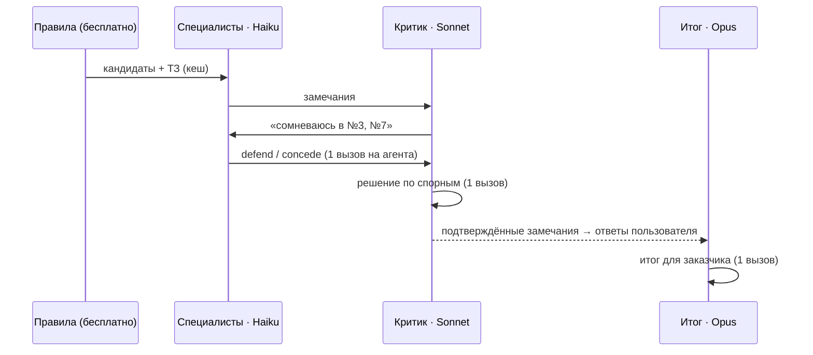
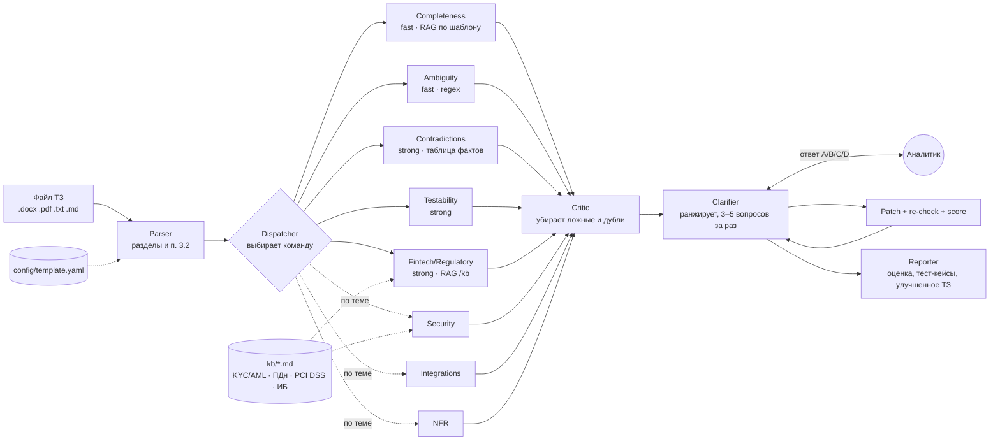

# Specta — ИИ-агент проверки требований

Команда **WinnerVision** · BCC-HUB × MNU FinTech Hackathon 2026.

Specta проводит **статическую проверку готового документа с требованиями** до разработки: нарезает его на отдельные
требования, проверяет каждое и набор целиком по **ISO/IEC/IEEE 29148:2018 (п. 5.2.5, 5.2.6)** и **IEEE Std 830-1998
(п. 4.3)** и записывает отчёт в файл. Документ не переписывается — только ревью: двусмысленность, непроверяемость,
противоречия, пропуски, лишние проектные решения. Каждое нарушение — с цитатой и местом в документе.

Сдача — команда в терминале: она читает документ и пишет отчёт. Сайт — отдельный разбор в чате, с вопросами и правками текста.

## Claude или Gemini

Один и тот же документ мы сравнивали на Claude и на Gemini. С Claude замечания точнее держатся за цитату, лучше видны противоречия между правилом и примером, единицами и датами, и реже пропадает настоящий дефект. Gemini проходит тот же сценарий бесплатно: команда и состав отчёта те же, формулировки слабее. Для результата, который сдаёте, берите Claude.

## Ключ Claude

1. Откройте https://console.anthropic.com и войдите.
2. **Settings → API keys**: https://console.anthropic.com/settings/keys → **Create Key**. Ключ показывают один раз — скопируйте его сразу.
3. В **Settings → Billing** на новом аккаунте нужны кредиты, иначе API ответит отказом. Бесплатного тарифа у Claude нет. Прогон без оплаты — Gemini, раздел ниже.
4. В корне проекта:

```bash
cp .env.example .env
```

В `.env` впишите `ANTHROPIC_API_KEY=ваш_ключ` и `LLM_PROVIDER=anthropic`. Файл в git не попадает.

## Проверка тестового документа организаторов

Положите выданный файл, например `docs/requirements.pdf`. Подойдут также `.docx`, `.md`, `.txt`. Сам документ в результат не входит и в git его коммитить не нужно. Результат — отчёт, который запишет команда.

Установка один раз (Python 3.11+):

```bash
python -m venv .venv && source .venv/bin/activate
pip install -r requirements.txt && pip install -e .
```

Прогон. Второй аргумент — куда положить отчёт:

```bash
CACHE=0 specta check docs/requirements.pdf report.md --provider anthropic
```

`CACHE=0` нужен для сдачи: иначе в паспорт попадут ответы прошлого прогона и длительность около нуля. Перед этим прогоном закоммитьте код, иначе в версии агента будет «незакоммиченные изменения».

Без установки пакета:

```bash
CACHE=0 .venv/bin/python -m app.cli check docs/requirements.pdf report.md --provider anthropic
```

Отчёт появится в `report.md`. В паспорте будут модель, коммит и шесть разделов: нарезка, каждое требование, набор, сводка, итог.

Если локально лежит markdown из репозитория задания, подставьте его вместо PDF:

```bash
CACHE=0 specta check docs/requirements.md report.md --provider anthropic
```

## Бесплатный прогон на Gemini

https://aistudio.google.com/apikey → **Create API key**. В `.env`: `GEMINI_API_KEY=ваш_ключ` и `LLM_PROVIDER=gemini`. Та же команда:

```bash
specta check docs/requirements.pdf report.md --provider gemini
```

Модель по умолчанию — `gemini-2.5-flash` (`GEMINI_MODEL`).

Агент принимает путь к файлу требований и путь к отчёту. Без второго пути отчёт ляжет в `reports/<имя_файла>_report.md`. Флаг `-o report.md` делает то же, что второй аргумент.

Во время прогона в терминале видно, какой агент сейчас работает и что делает: агенты — те же стеклянные персонажи,
что и на сайте, отрисованные через `chafa` в файлы `app/review/term_art/<агент>/<кадр>.ans`. Агент появляется, у него
меняется выражение глаз, он смотрит влево и вправо и моргает; следующий агент сменяет предыдущего. Кадры пересобираются
командой `python scripts/build_term_art.py` (нужны Node, Chrome и `chafa`), для запуска они не нужны — лежат в репозитории.
В CI и при перенаправлении вывода печатается обычный лог, `--no-anim` выключает анимацию.

| Флаг | Что делает |
|---|---|
| `report.md` или `-o report.md` | куда записать отчёт |
| `--provider gemini\|anthropic\|openai\|deepseek\|custom` | какой LLM API взять (по умолчанию — первый, чей ключ есть в `.env`) |
| `--offline` | без модели, только проверки правилами |
| `--json result.json` | дополнительно сохранить результат в JSON |
| `--no-anim` | без анимации |
| `--demo` | показать анимацию агентов без модели и без трат: проверки правилами, с паузами между шагами |

**Через Docker** (без установки Python): положите документ в папку `docs/` и выполните

```bash
docker compose run --rm -v "$PWD/docs:/docs" specta python -m app.cli check /docs/requirements.pdf /docs/report.md --provider anthropic --no-anim
```

## Какие LLM поддерживаются

Агент подключается к любому LLM API. Достаточно одного ключа в `.env`. `LLM_PROVIDER=auto` (по умолчанию) берёт Claude, если есть `ANTHROPIC_API_KEY`, иначе первый другой ключ. `--provider` выбирает явно. Модель и версия агента (коммит) записываются в паспорт отчёта.

| Провайдер | `--provider` | Ключ в `.env` | Модель по умолчанию | Где взять ключ |
|---|---|---|---|---|
| Anthropic Claude (для сдачи) | `anthropic` | `ANTHROPIC_API_KEY` | Haiku 5.5 — требования, Sonnet 5.5 — набор и Критик | https://console.anthropic.com/settings/keys |
| Google Gemini (бесплатно) | `gemini` | `GEMINI_API_KEY` | `gemini-2.5-flash` (`GEMINI_MODEL`) | https://aistudio.google.com/apikey |
| OpenAI | `openai` | `OPENAI_API_KEY` | `gpt-4o-mini` (`OPENAI_MODEL`) | https://platform.openai.com/api-keys |
| DeepSeek | `deepseek` | `DEEPSEEK_API_KEY` | `deepseek-chat` (`DEEPSEEK_MODEL`) | https://platform.deepseek.com |
| Любой OpenAI-совместимый API (OpenRouter, Groq, Mistral, Together…) | `custom` | `LLM_BASE_URL`, `LLM_API_KEY`, `LLM_MODEL` | — | у провайдера |

Claude подключается через официальный Anthropic SDK, остальные — через один адаптер протокола OpenAI Chat
Completions (`app/openai_compat.py`) со строгой JSON-схемой ответа; если API не принимает схему, адаптер переходит в
режим JSON, при лимите запросов (429) — повторяет с паузой. Для Критика и проверки набора можно задать модель
сильнее: `GEMINI_MODEL_STRONG`, `OPENAI_MODEL_STRONG` и т.п.

## Что в отчёте

1. **Паспорт прогона** — документ, файл, дата, модель, версия агента (git-коммит), критерии.
2. **Как агент нарезал требования** — таблица «ID в отчёте — ID / место в документе — раздел — краткая формулировка».
   Номера документа (Ф-1, п. 3.2) сохраняются; где номеров нет — указывается место («Критерии приемки, строка 2»).
3. **Проверка каждого требования** — матрица 9 свойств ISO 29148 §5.2.5 и замечания: цитата, проблема, как исправить.
4. **Проверка набора** — 8 свойств (§5.2.6 + IEEE 830 §4.3): полнота, согласованность, выполнимость, понятность,
   валидируемость, ранжирование, модифицируемость, трассируемость.
5. **Сводка** — число требований и нарушений, список критичных (непроверяемые, противоречивые, неполные),
   вопросы к аналитику.
6. **Итог** — можно ли начинать разработку и тестирование, что исправить в первую очередь.

## Как устроен агент проверки (`app/review/`)

```
документ ─▶ Парсер ─▶ Нарезка ─▶ Правила ─▶ Аналитик требований ×N ─▶ Согласованность ─▶ Критик ─▶ Уточнитель ─▶ отчёт
 PDF/DOCX   разделы,  R-01…     (детерми-   (по 9 свойствам,          (набор целиком,     (цитата      (вопросы
 MD/TXT     таблицы   + ID док. нированно)  пакетами, параллельно)    A ↔ B, приёмка)     есть? дубль?) аналитику)
```

| Шаг | Файл | Модель | Что делает |
|---|---|---|---|
| Парсер | `app/parsing.py` | — | восстанавливает структуру PDF по шрифтам и координатам: заголовки, таблицы (колонки, перенос ячеек, повтор шапки), списки |
| Нарезка | `review/slicer.py` | — | выделяет требования, сохраняет ID документа и цитату; служебные блоки (паспорт, чек-лист, согласования) — в проверку набора |
| Правила | `review/checks.py` | — | размытые слова, атомарность, HTTP-семантика, пустые значения, единицы, заглушки, версия, ID, приоритеты, лишние проектные решения |
| Аналитик | `review/agents.py` | быстрая | каждое требование по 9 свойствам 29148 §5.2.5 со строгой схемой ответа |
| Согласованность | `review/agents.py` | сильная | противоречия между требованиями, с критериями приёмки и дочерним документом, пропущенные сценарии |
| Критик | `review/pipeline.py` + `agents.py` | сильная | снимает замечание без цитаты в документе; имя класса и поле хранения не снимает |
| Уточнитель | `review/agents.py` | быстрая | 5–8 вопросов аналитику с вариантами ответа |
| Отчёт | `review/report.py` | — | Markdown строго по разделам задания |

Документ уходит в каждый вызов как общий кешируемый блок. Персональные данные (ИИН, телефоны, карты, IBAN, e-mail)
маскируются перед отправкой в модель. Прогон на документе организаторов: ~45–100 с, 7 вызовов модели.

## Веб-интерфейс

Сайт не пишет отчёт для сдачи. Отчёт пишет команда `specta check` выше. Сайт открывает документ в чате.

## Запуск сайта в Docker

```bash
docker compose up --build
```

Откройте http://localhost:8000. Ключи берутся из того же `.env`: `ANTHROPIC_API_KEY` или `GEMINI_API_KEY`. Если ключа нет, сайт отвечает правилами, без модели.
Кеш и опыт команды хранятся в томе `specta-data`.

## Персональные данные

Перед отправкой в любой LLM API (`app/pii.py`) ИИН/БИН, телефоны, номера карт, IBAN и e-mail заменяются метками
`[ИИН-1]`, а в ответе модели метки возвращаются к исходным значениям — цитаты по-прежнему совпадают с документом.
Сколько значений скрыто — видно в панели «Как работали агенты». `PII_MASK=0` отключает.

## Запуск без Docker (3 команды)

```bash
pip install -r requirements.txt
```

```bash
cp .env.example .env
```

```bash
uvicorn app.main:app --reload
```

Откройте http://localhost:8000 и нажмите **«Попробовать на примере ТЗ»**.

Ключи в `.env` (файл в `.gitignore`, в git не попадает):

| Переменная | Зачем |
|---|---|
| `ANTHROPIC_API_KEY` | Claude для сайта и для CLI. Если этого ключа нет, но есть `GEMINI_API_KEY`, берётся Gemini. Без любого ключа работают только правила |
| `SUPABASE_URL`, `SUPABASE_SECRET_KEY` | аккаунты и сохранение проверок. Секретный ключ используется **только на сервере** |
| `LLM_MAX_CALLS`, `DEBATE_MAX_CHALLENGES` | потолок вызовов Claude на одну проверку и число спорных замечаний в обсуждении |

**База данных.** Один раз выполните `supabase/migrations/20261119000000_init.sql` в Supabase
(Dashboard → SQL Editor → New query → Run). Пока таблиц нет, сервер сам сохраняет проверки в приватный
бакет Supabase Storage `specta`, так что регистрация и история работают сразу; после миграции запись идёт в таблицы.

## Модели Claude и обсуждение агентов

| Роль | Модель | Что делает | Сколько вызовов |
|---|---|---|---|
| Специалисты (Полнота, Ясность, …) | Claude Haiku 5.5, effort low | дополняют то, что нашли правила | ≤ 1 на агента |
| Авторы замечаний в споре | Claude Haiku 5.5, effort low | защищают или снимают замечание | ≤ 1 на агента |
| Критик / модератор | Claude Sonnet 5.5, effort medium | оспаривает сомнительное и выносит решение | 2 |
| Итог для заказчика | Claude Opus 5.5, effort low | одна страница на понятном языке | 1 |
| Тест-кейсы | Claude Haiku 5.5 | приёмочные кейсы Дано/Когда/Тогда | 1 |

Как экономятся кредиты:

1. **Сначала бесплатные правила.** Regex, таблица фактов, сверка с шаблоном и базой знаний находят основное; Claude только уточняет и спорит.
2. **Кеш промпта.** Текст ТЗ отправляется первым системным блоком с `cache_control`, одинаковым для всех агентов: повторное чтение стоит ~10% цены входа.
3. **Структурированные ответы** (`messages.parse` + Pydantic) — нет повторов из-за битого JSON.
4. **Спор ограничен по раундам, а не по размеру документа:** Критик выбирает не больше `DEBATE_MAX_CHALLENGES` замечаний → авторы отвечают пачкой (1 вызов на агента) → Критик выносит решения одним вызовом.
5. **Потолок `LLM_MAX_CALLS`** на проверку и счётчик стоимости: сумма в долларах сохраняется вместе с проверкой (`cost_usd`).



### Агенты с инструментами (Claude tool use)

Специалисты — не просто промпты: на своём шаге агент сам решает, какие данные ему нужны, вызывает инструменты
и только потом отвечает строго по схеме. Цикл — `LLM.run_agent` в `app/llm.py`, до 3 раундов инструментов на агента.

| Инструмент | Что даёт | У кого |
|---|---|---|
| `search_kb` | база знаний РК: KYC/AML, ПДн, PCI DSS, НБ РК, ИБ | Комплаенс, Безопасность, Полнота |
| `template_checklist` | какие обязательные разделы шаблона банка есть, а каких нет | Комплаенс, Безопасность, Полнота |
| `get_facts` | таблица чисел ТЗ: лимиты, комиссии, сроки — с пунктами | Согласованность |
| `search_tz`, `get_section` | все упоминания темы и точный текст пункта | все специалисты |

Инструменты — обычный Python над локальными данными (`app/agents/tools.py`): без сети, детерминированные, бесплатные.
Диспетчер тоже работает на Claude Haiku (`decide_llm`), а выбор по ключевым словам остаётся подсказкой и запасным вариантом.
Цикл проверен тестом с поддельным клиентом (`tests/test_agent_loop.py`): вызов инструмента → результат → ответ, кеш, стоимость.

### Бесплатный веб-ресёрч (`app/research.py`)
Когда в локальной базе знаний нет нужной нормы или надо уточнить номер/редакцию закона, агент «Комплаенс»
(и любой агент в ответе на `@`-вопрос) может вызвать `web_search` → `read_page`. Без платных API и ключей:
- поиск — HTML-эндпоинт DuckDuckGo, при сбое — API Википедии; `official=true` ограничивает поиск
  adilet.zan.kz, nationalbank.kz, gov.kz, afm.gov.kz, ardfm.kz;
- страница возвращается не целиком, а только фрагменты по теме (экономит токены); adilet читается через `old.adilet.zan.kz`;
- ограничения: только публичные http(s)-адреса (внутренние недоступны), не больше `WEB_MAX_CALLS` (6) запросов на
  проверку, кеш на сутки, в запрос идёт только общая тема нормы, без данных из ТЗ; `WEB_RESEARCH=0` отключает.

### Постоянный кеш и опыт команды (`app/cache.py`, `app/learning.py`)
Один файл SQLite `data/cache.sqlite` (в `.gitignore`):
- **Ответы агентов.** Ключ — хеш модели, промптов, текста ТЗ, схемы ответа и инструментов. Каждая запись помечена
  отпечатком знаний: файлы `kb/`, `config/`, код агентов. Изменили базу знаний, правила или промпт — старые ответы
  перестают совпадать и удаляются при старте. Повторная проверка того же ТЗ: 0 вызовов Claude, $0, меньше секунды.
- **Веб-источники.** Поиск живёт сутки, страница — 3 дня (`WEB_PAGE_TTL_DAYS`). Потом она перепроверяется по
  ETag / Last-Modified / хешу текста. Не изменилась — продлеваем. Изменилась (вышла новая редакция закона) —
  сохраняем новую и удаляем все ответы агентов, построенные на старой; агент сам видит пометку «страница изменилась».
  Источник недоступен — отдаём старую копию с пометкой даты.
- **Опыт.** (1) Какой вариант аналитики выбирают для типовой проблемы — в карточке «Чаще выбирают…»; считаются только
  правила, без текста клиента. (2) Замечания, которые Критик снял в споре, становятся «уроками» для этого агента в
  следующих проверках (до 5 на агента, 90 дней, только внутри аккаунта — чужие ТЗ не утекают). Уроки не входят
  в ключ кеша: то же ТЗ берёт уже обсуждённый ответ, новое — проверяется с учётом опыта.

`CACHE=0`, `LEARNING=0` отключают; `GET /api/cache` — счётчики (сколько записей, попаданий, сэкономлено).

### Меньше вопросов, то же ТЗ (`agents/clarifier.py`)
1. **Повторы** — один вызов Haiku находит вопросы разных агентов об одном решении; остаётся самый важный,
   ответ на него закрывает и остальные (в карточке: «Тот же вопрос был у …»).
2. **Группы** — некритичные уточнения одной темы (размытые формулировки, непроверяемые требования, недостающие
   разделы, типовые требования регулятора) собираются в одну карточку со списком. Вариант A применяет ровно те же
   правки, что и ответы «A» по каждому пункту (это проверяет тест), «Разобрать по одному» разворачивает группу.
   Критичные вопросы и противоречия в цифрах всегда задаются по одному.

На примере ТЗ: 54 уточнения → 20 вопросов.

### Трассировка — «Как работали агенты»

Кнопка в шапке чата открывает хронологию проверки: каждый вызов Claude (агент, модель, токены, доля из кеша, стоимость),
каждый вызов инструмента и каждый проход правил; сверху итог по моделям и стоимость всей проверки.
Те же данные отдаёт `GET /api/trace/{id}` и сохраняет история проверок.

## Аккаунты, история и ссылка для заказчика

- Регистрация и вход — Supabase Auth (через сервер; браузер не видит секретный ключ).
- Каждая проверка сохраняется вместе с чатом, версиями ТЗ, обсуждением агентов и итогом. «Мои проверки» в меню аккаунта
  открывают любую из них, даже после перезапуска сервера.
- «Ссылка для заказчика» в итоговой карточке создаёт страницу `/r/<токен>`: оценка до/после, вывод, что улучшили,
  оставшиеся риски, следующие шаги и кнопка скачать улучшенное ТЗ. Без входа и только для чтения.

## Архитектура



**Принципы**

- Всё, что можно сделать кодом, сделано кодом: regex для размытых слов, таблица фактов (лимиты, сроки, комиссии, даты)
  для противоречий, сверка с шаблоном, keyword-RAG по локальной базе знаний и скоринг. LLM подключается только там,
  где нужно рассуждение: дополнительный проход агента, второе мнение Критика, тест-кейсы, ответы в чате.
  Если LLM недоступен, агенты откатываются на правила.
- Команда задаётся конфигом. `app/agents/registry.py` → `AGENTS`: имя, роль, форма и цвет аватара, эмоции,
  tier модели (`fast` | `strong`), инструменты (`rag` / `facts_table` / `regex` / `web_search` / `none`) и
  триггеры, по которым Диспетчер решает, нужен ли агент.
- Одна схема событий для всех агентов (`app/models.py → Event`):
  `{id, agent, type: status|finding|question|score|applied|done, severity, section_ref, text, quote, options[{key,label}], allow_custom, emotion, data}`.
  Фронтенд рендерит только эту схему, кода под конкретных агентов в нём нет.
- Шаблон не зашит в код. `config/template.yaml` описывает ожидаемые разделы ТЗ (имя, синонимы, обязательность,
  подсказки, типовой текст). 25 ноября этот файл заменяется шаблоном организаторов, код менять не нужно.
  Словари правил лежат в `config/rules.yaml`.
- Скоринг 0–100 по пяти критериям: полнота, ясность, тестируемость, согласованность, комплаенс.
  Штраф за открытое замечание: критичное 18, важное 10, желательное 4. Оценка критерия = `100·e^(−штраф/80)`.
  Итог — среднее по критериям, пересчитывается после каждого ответа.

## Структура

```
app/
  main.py          FastAPI: REST + SSE, раздаёт static/
  orchestrator.py  пайплайн анализа, чат, ответы, undo, re-check, команды
  agents/          registry, base, dispatcher, completeness, ambiguity, contradictions,
                   testability, kbcheck (regulatory + security), integrations, nfr, critic, clarifier
  llm.py           Claude API (официальный SDK): модели по ролям, кеш ТЗ, счётчик стоимости
  db.py            Supabase: Auth, сохранение проверок (таблицы или Storage), ссылки для заказчика
  agents/debate.py обсуждение: Критик оспаривает, авторы отвечают, Критик решает
  parsing.py       docx / pdf / txt / md → нумерованные разделы, сопоставление с шаблоном
  patching.py      применение и откат правок ТЗ
  scoring.py, export.py, store.py (сессии в памяти), kb.py (RAG), models.py
config/            template.yaml, rules.yaml
kb/                локальная база знаний (KYC/AML, ПДн, PCI DSS, ИБ)
samples/           sample_tz_p2p.md (22 заложенных дефекта) + expected_defects.yaml
static/            index.html, css/, js/ (ES-модули, без сборки и фреймворков)
tests/             pytest: парсинг, скоринг, схема событий, API, поиск дефектов
scripts/check_sample.py
```

## API

| Метод | Путь | Что делает |
|---|---|---|
| POST | `/api/upload` | multipart `file` (или `sample=true`), `context` → `{session_id}` |
| GET | `/api/analyze/{id}/stream` | SSE: шаги thought chain (`step` / `item` / `done`) |
| GET | `/api/chat/{id}/stream` | SSE: события агентов (единая схема), поддерживает `Last-Event-ID` |
| POST | `/api/chat/{id}/answer` | `{question_id, choice_key \| custom_text}` |
| POST | `/api/chat/{id}/undo` | `{question_id}`: откатить ответ |
| POST | `/api/chat/{id}/message` | `{text}` или `{command: findings\|questions\|improve\|tests\|score\|report}` |
| POST | `/api/chat/{id}/attach` | дополнительный файл (приложение к ТЗ) |
| GET | `/api/doc/{id}` | текущий текст ТЗ, подсветки, версии |
| GET | `/api/report/{id}` | отчёт JSON |
| GET | `/api/report/{id}/export?format=md\|docx&kind=tz\|report` | улучшенное ТЗ или отчёт |

## Тесты

```bash
python -m pytest -q
```

```bash
python -m scripts.check_sample
```

`check_sample` прогоняет агентов по демо-ТЗ и проверяет, что найдено не меньше 80% заложенных дефектов,
а заложенное ложное срабатывание («быстро — не позднее 30 секунд») удалено Критиком. Сейчас находится 22 из 22.

## Фронтенд

Только HTML + CSS + vanilla JS (ES-модули). React, Tailwind и шагов сборки нет. Все строки интерфейса лежат
в `static/js/i18n.js` (добавьте словарь `kk` / `en`). Иконки — inline SVG в стиле Lucide. Аватары агентов —
SVG-«блобы» с градиентами, свечением и 8 эмоциями (`static/js/blobs.js`); эмоция всегда отражает реальное
состояние агента. Анимации укладываются в 200–300 мс, `prefers-reduced-motion` учитывается.
На мобильных панель «Документ» открывается снизу (bottom sheet).
